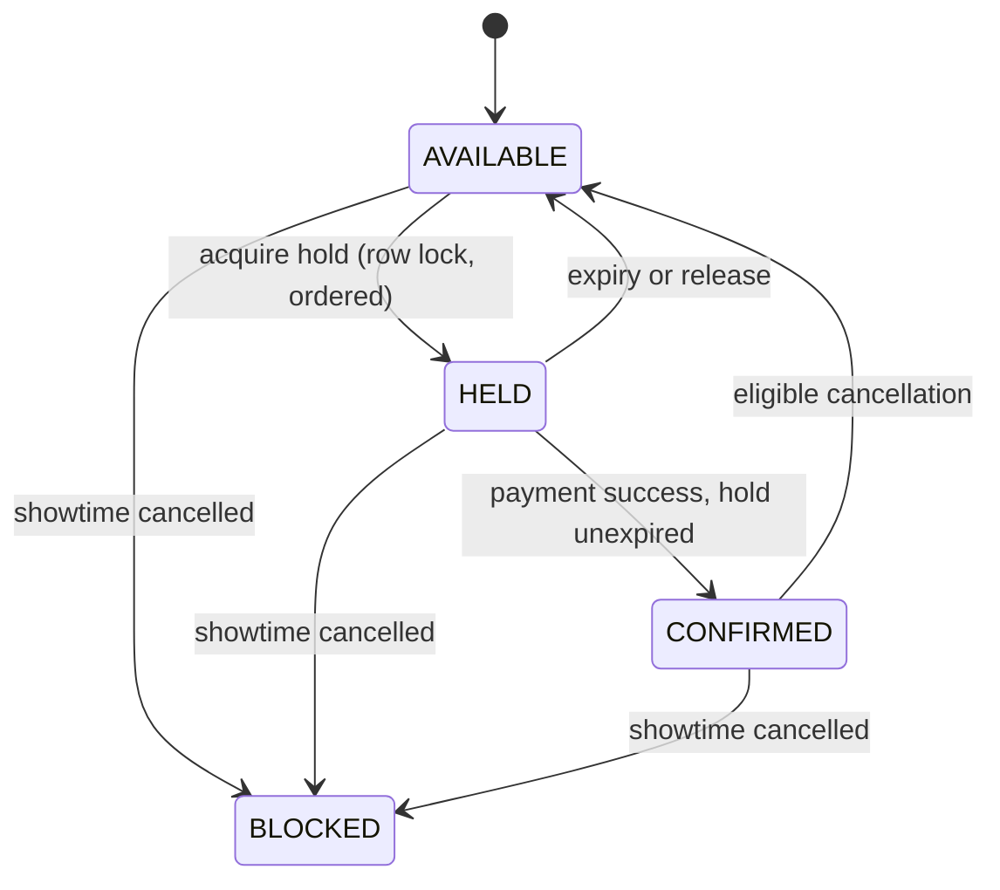

# Seatly

A cinema seat reservation system built on **Laravel 13 · Inertia · Vue 3 · PostgreSQL 16**,
written as a study in the one thing seat booking is actually hard at:

> **Two people. One seat. The same instant.**

`248 tests / 688 assertions` · concurrency gate passed under **600 coordinated attempts**
· every phase gated on recorded evidence before the next one starts

---

## The invariant everything else serves

> For one showtime and one seat, there can be at most one confirmed booking.

PostgreSQL is the final authority for seat ownership. Browser state, cache, application
memory and background workers are never the final allocation authority.



## The proof, before the polish

The rule was that no payment or UI work could begin until the invariant survived real
contention. It was measured, not asserted:

```bash
php artisan seatly:concurrency-gate --attempts=100 --runs=3 --seed=20260810
```

| Scenario | Runs | Attempts | Held | Conflict | Errors | Deadlocks |
|---|---:|---:|---:|---:|---:|---:|
| same seat | 3 | 300 | 1 per run | 99 per run | 0 | 0 |
| overlapping groups | 3 | 300 | 1 per run | 99 per run | 0 | 0 |

Exactly one winner every run. Every loser a deterministic `SEAT_TAKEN`. Zero deadlocks —
counted from `pg_stat_database.deadlocks`, not inferred from retry counts.

The interesting part is proving those attempts genuinely overlapped rather than queued in
the harness: a **50 ms start spread across 100 forked processes**, and a latency spread of
**90 ms to 1.9 s** — the shape of a hundred transactions waiting on one lock, not of a
serialized loop. Deadlock freedom comes from a fixed lock order: showtime first, then
inventory rows by ascending seat ID.

Full run record, environment fingerprint and raw JSON:
[`docs/evidence/H3-04/`](docs/evidence/H3-04/green.md)

## What is built, and what is not

| | Phase | State |
|---|---|---|
| ✅ | 0–1 · Foundation, PostgreSQL-only test harness, release gates | Done |
| ✅ | 2 · Movie/venue/hall catalogue, showtime publishing, authoritative seat inventory | Done |
| ✅ | 3 · Seat holds, idempotency middleware, concurrency stop gate | Done |
| ▢ | 4 · Hold lifecycle and the accessible seat grid | Next |
| ▢ | 5 · Simulated payment and booking confirmation | Planned |
| ▢ | 6 · Booking reference, QR, cancellation | Planned |

**There is no seat-picking screen yet.** Phase 3 ends at the authoritative seat-map
endpoint and the hold API; the grid that consumes them is Phase 4. Saying so is the point
of the method — [`docs/RELEASE_GATES.md`](docs/RELEASE_GATES.md) forbids promotion past a
gate that has not produced evidence, and that applies to the README too.

## Stack

Laravel `13.24` · PHP `8.5.3` · PostgreSQL `16.14` · Vue `3.5` + Inertia `3.3` ·
Tailwind · Pest/PHPUnit `12.5` · Playwright `1.62` · Node `24.13`

Modular monolith. Database queue and Laravel scheduler. No Redis, Kafka, WebSockets or
Kubernetes — see [non-goals](#explicit-non-goals-for-mvp).

## Running it locally

```bash
docker compose up -d                  # postgres:16.14 — seatly_dev + seatly_test
composer install && npm install
cp .env.example .env && php artisan key:generate
php artisan migrate
composer dev                          # web, queue worker, log tail, and Vite
```

Tests, by layer:

```bash
php artisan test --testsuite=Unit
php artisan test --testsuite=Feature
php artisan test --testsuite=Integration   # real PostgreSQL; fails loudly on SQLite
npx playwright test
composer ci:check                          # the whole chain
```

The integration suite refuses to run on SQLite by design. The concurrency behaviour under
test is PostgreSQL's, so a green run on another engine would prove nothing.

## MVP journey

```text
Browse movies
  → Select venue and showtime
  → Select seats
  → Register/Login at the hold request
  → Create five-minute server-side hold
  → Simulated payment
  → Confirm booking
  → Receive booking reference and QR
  → View or cancel booking
```

Authentication begins at the hold request and nowhere earlier — browsing needs no account
(`ADR-014`).

## How it was built

The code is half of it. Each phase starts from a written specification and closes with a
recorded red-then-green evidence file, so any claim in this README can be traced back to
the run that produced it.

- [Business Requirements Document](docs/BRD.md) — scope, actors, business rules
- [Architecture Decisions](docs/DECISIONS.md) — 20 ADRs, each with the alternative rejected
- [Domain State Models](docs/DOMAIN_STATE_MODELS.md) — every state, transition and *forbidden* transition
- [Release Gates](docs/RELEASE_GATES.md) — what must be proven before promotion

<details>
<summary>All project documents</summary>

- [Start Here for Claude Code](START_HERE.md)
- [Claude Code Contract](CLAUDE.md)
- [Implementation Backlog](IMPLEMENTATION_BACKLOG.md)
- [Baseline Reconciliation Record](docs/BASELINE_RECONCILIATION.md)
- [Project Brief](docs/PROJECT_BRIEF.md)
- [Delivery Timeline](docs/DELIVERY_TIMELINE.md)
- [Approved MVP Policy and Operational Baseline](docs/MVP_POLICY_BASELINE.md)
- [Logical ERD Specification](docs/LOGICAL_ERD.md)
- [Sprint 0 Review Decisions](docs/SPRINT_0_REVIEW_DECISIONS.md)
- [Sprint 0 Exit Checklist](docs/SPRINT_0_EXIT_CHECKLIST.md)
- [Traceability Matrix](docs/TRACEABILITY_MATRIX.md)
- [Editable BPMN diagram (Draw.io)](docs/diagrams/seatly-booking-process.drawio)
- [Editable Logical ERD (Draw.io)](docs/diagrams/seatly-logical-erd.drawio)
- [Editable State Machines (Draw.io)](docs/diagrams/seatly-state-machines.drawio)
- [Semantic BPMN 2.0 XML](docs/bpmn/seatly-booking-process.bpmn)
- [Phase evidence, red and green, per task](docs/evidence/)

</details>

## Explicit non-goals for MVP

Real payment and refund integration · guest checkout · loyalty, vouchers, promotions and
food ordering · dynamic pricing and multi-currency · multi-brand tenancy · drag-and-drop
hall designer · offline QR validation · native mobile application · Redis, Kafka,
WebSockets, microservices and Kubernetes.

---

Built by [Fatihi Azmi](https://github.com/fatihiazmi).
